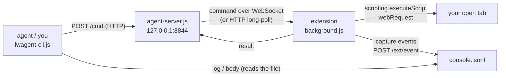

# live-browser-agent

A Firefox/LibreWolf extension plus a tiny local bridge that lets a coding agent (I use Claude Code) look at the tab I already have open: its DOM, page text, console errors and network traffic, including child frames, without restarting the browser and without the `navigator.webdriver` flag that bot walls look for.

> **Status: work in progress.** I use the reading side (tabs, eval, text, capture) on my own browser; the request-patching side is built but has never been run against a real page, and things still change.

## Why I built it

When a site breaks for me, the question is always "what does MY tab see": my logins, my cookies, my uBlock Origin and Pi-hole filtering. Playwright-style tools answer a different question. They open a fresh, logged-out browser profile with no extensions, and that browser announces itself as automated.

The obvious alternative is to start my real browser with `--remote-debugging-port`. I tried that and kept it for less than a day. With the port open, `navigator.webdriver` is `true` on every page, even with no client attached, and there is no pref to turn that off. I checked it with a local test page that reported the value back: no flag gives `false`, flag gives `true`. Within an hour I was getting "robot or human?" challenges on ordinary browsing and a Cloudflare check on sites I use every day. The port also cannot be opened on a browser that is already running, so every debugging session meant quitting and losing my tab state.

An extension lives inside the browser, needs no debug port, and can be switched on and off with a toolbar button. So I built one, and a bridge so an agent on the same machine can talk to it.

The first real problem it solved: a retail site's bot-check widget showed up as an empty grey box I could not click. The page console showed nothing useful. A capture showed the widget's script request failing with `NS_ERROR_ABORT`, which in Firefox means an extension cancelled it. It was uBlock Origin, on a first-party path, which is why allowing the vendor's domains in Pi-hole had not fixed it.

## How it works



- **The extension dials out.** A browser extension cannot listen on a socket, so `background.js` opens a WebSocket to the bridge on `127.0.0.1:8844` and commands are pushed down it. If `ws://` will not open, it falls back to HTTP long-polling. Same commands either way.
- **The bridge** (`agent-server.js`) is one file with no dependencies. The WebSocket side is a small hand-written RFC 6455 implementation, so there is nothing to `npm install`.
- **The CLI** (`lwagent-cli.js`) sends a command and prints the answer, so an agent can use it from a normal shell.
- **Off until you click it.** On a fresh install the extension holds no socket, no listeners and no injected scripts. The toolbar button or Ctrl+Shift+U turns it on, and the badge shows `on`. Turning it off clears every capture and patch rule. The on/off state is remembered across browser restarts, so if you leave it on it comes back on.

### Commands

| Command | What it does |
|---|---|
| `tabs` | List open tabs: id, flags (`*` active, `P` pinned, `z` sleeping), URL, title |
| `eval [--tab=N] [--frames] "expr"` | Run a JavaScript expression in the page's own context (sees the page's globals). `--frames` runs it in every frame and returns one result per frame |
| `text [--tab=N] [--frames]` | The page's readable text |
| `capture_start --tab=N` / `capture_stop --tab=N` | Record console output, page errors, requests, responses, failed loads, and text response bodies (up to 512 KB each) for that tab |
| `captures` | What is being captured, and how many network listeners are attached (should be 5) |
| `log [pattern]` | Show recent capture events, optionally filtered |
| `body <url-part>` | Print a captured response body |
| `patch_set --rules='[...]'` / `patch_clear` / `patches` | Drop or redirect requests, merge request or response headers, replace a response body. Untested on a real page |

Reading is the intended use. Nothing in the code enforces read-only: `eval` can run any JavaScript in the page, and `patch_set` can change traffic. I keep agents to reads by instruction, not by mechanism.

### Why Manifest V2

It started as MV3 and broke three ways in Firefox:

1. With MV3 origin controls, the `host_permissions` were never actually granted.
2. The MV3 background event page gets suspended, which silently killed the connection loop.
3. The MV3 base content security policy does not allow localhost. Every connection to the bridge was blocked, so the extension toggled on and sent zero packets.

Firefox's MV2 base CSP allows `http://127.0.0.1:*`, and in the Firefox build I tested the `scripting` API (including `world: "MAIN"` for page-context eval) works under MV2. Firefox also still supports blocking `webRequest`, which is what capture and patching use. Nothing was lost by staying on MV2.

### Things worth knowing

- **A blocked request makes no console error.** When uBlock Origin or a DNS blocker stops a request, the page console often shows nothing, or a generic "CORS request did not succeed". The `loading_failed` event is the signal. `NS_ERROR_ABORT` usually means an extension cancelled it.
- **Strict page CSP blocks `eval`.** Many retail and banking sites forbid `eval()` in the page. When that happens, `eval` retries in the extension's isolated world, which shares the DOM but not the page's JavaScript globals, and says so in the result. `--world=isolated` forces it.
- **Sleeping tabs and `about:` pages cannot be read.** The error says which one it is.
- **`eval` does not wait for a promise.** For async work, store the result on `window` and read it with a second `eval`.
- **"Channel is delivering cached alt-data"** shows up as `response_body_unavailable`. It is not a failure: the response came from cache, so there was no body to copy. A hard reload gets them.

### Security

The bridge binds to `127.0.0.1` only and has no authentication. While the toggle is on, any local process can send it commands, and that includes running JavaScript in your logged-in tabs. Turn the toggle off when you are done.

`/cmd` refuses any request that carries an `Origin` header, so a web page in your browser cannot use it to drive another tab. The extension-side endpoints (`/ws`, `/ext/*`) are not restricted that way, so a malicious page that knows about the bridge could still connect to them while it is running. Capture writes page data, including response bodies, to `~/.cache/lwagent/console.jsonl`; delete it when you no longer need it.

## Measured

From my own capture log, 2026-09-12 to 2026-10-03: 4 captures, 2,140 events in total.

The capture that found the grey widget (2026-09-12, one tab, 1,782 events):

| | n |
|---|---:|
| responses | 447 |
| ...with HTTP status 400 or higher | 0 |
| `loading_failed` | 8 |
| ...`NS_ERROR_ABORT` (cancelled by an extension) | 7 |
| console messages captured | 0 |
| text response bodies captured | 148 |
| ...cut at the 512 KB cap | 2 |
| `response_body_unavailable` | 269 |
| ...of those, "cached alt-data" (not a failure) | 268 |

That is the case the tool exists for: every HTTP response was fine and the console was silent, and the only sign of the problem was 7 requests cancelled by an extension.

## Install

You need:

- Firefox or LibreWolf, version 128 or newer. I have only used it with LibreWolf on Debian Linux.
- Node.js 18 or newer (`node --version`)

1. Get the code: `git clone` this repo, or download it as a zip and unpack it.
2. Try it without signing (lasts until the browser restarts):
   1. Open `about:debugging#/runtime/this-firefox`
   2. Click **Load Temporary Add-on...**
   3. Pick `extension/manifest.json`
3. For a permanent install, sign it yourself. Release builds of Firefox and LibreWolf only install signed add-ons.
   1. Change `browser_specific_settings.gecko.id` in `extension/manifest.json` from the all-zero placeholder to your own unique id: a fresh GUID in braces, for example the output of `uuidgen` wrapped as `{...}`. Mozilla ties the id to your account.
   2. Make API credentials at https://addons.mozilla.org/developers/addon/api/key/
   3. Export them and sign. They go in through the environment, never on the command line, because command-line arguments are visible to every process on the machine:
      ```bash
      export WEB_EXT_API_KEY=...      # "JWT issuer"
      export WEB_EXT_API_SECRET=...   # "JWT secret"
      ./sign.sh
      ```
      `sign.sh` can also take a file that exports those two (keep it `chmod 600`). It signs as an unlisted add-on, which is for your own use and is not published on the add-on store. Bump `version` in the manifest before each new signing; Mozilla rejects a repeat.
   4. In `about:addons`, click the gear, **Install Add-on From File...**, and pick the `.xpi` from `dist/`.

   Mozilla's linter currently warns that new extensions should declare `data_collection_permissions`. My builds signed without it in September 2026, but a brand-new add-on id may need it.

## Running it

```bash
node agent-server.js &          # the bridge, on 127.0.0.1:8844
# click the toolbar button (or Ctrl+Shift+U): the badge shows "on"

node lwagent-cli.js tabs
node lwagent-cli.js eval --tab=42 "document.title"
node lwagent-cli.js text --tab=42

node lwagent-cli.js capture_start --tab=42
node lwagent-cli.js captures            # expect wired:true, listeners:5
# reload the page or reproduce the problem
node lwagent-cli.js log loading_failed
node lwagent-cli.js body api/cart
node lwagent-cli.js capture_stop --tab=42
```

Put it on your PATH as `lwagent` if you like: `ln -s "$PWD/lwagent-cli.js" ~/.local/bin/lwagent`.

To hand it to Claude Code, a few lines in your `CLAUDE.md` or a skill are enough: where the CLI is, that the toggle is yours to click, to stop every capture it starts, and to read only unless you ask for more.

The port is 8844. The bridge and CLI read `LWAGENT_PORT` and `LWAGENT_LOG`, but the extension has 8844 written into `background.js` and the manifest's CSP, so changing the port means editing those too and reloading the extension.

### Tests

```bash
node --test test/*.test.js
```

Five tests run the bridge and the CLI against a fake extension that speaks raw, masked WebSocket frames over TCP. No browser is involved. They cover the handshake, command round trips, 70 KB messages in both directions (the 16-bit and 64-bit frame length paths), the extension disconnecting (the CLI must fail in under 2 s instead of hanging), the long-poll fallback, the `Origin` refusal, and reading the capture log.

The extension itself (`background.js`) has no automated tests. It was checked by hand in my own browser.

## What is not included

- **My signed `.xpi`.** It is signed to my Mozilla account. Sign your own as above.
- **Capture logs.** They are my browsing.
- **The BiDi route.** I also keep a small toolkit that relaunches the browser with the debug port for the one thing this extension cannot do (rewrite a request body). It is separate, it trips bot walls, and it is not part of this repo.

## Built with Claude Code

I built and debugged this with Claude Code, and Claude Code is the main thing that uses it. Two of the bugs it had (network listeners that were never attached while capture reported itself as running) were found by pointing it at a real page and asking why it saw nothing.

## License

MIT
